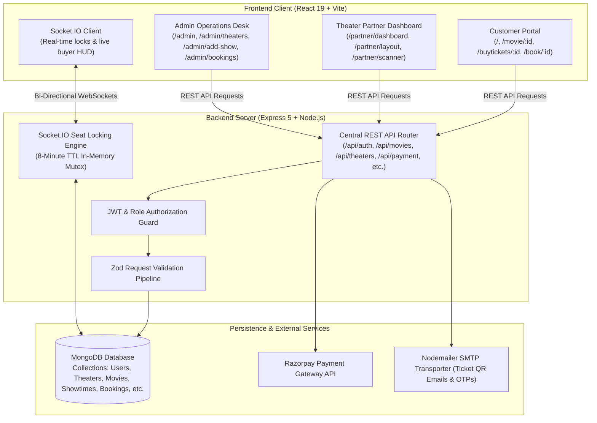
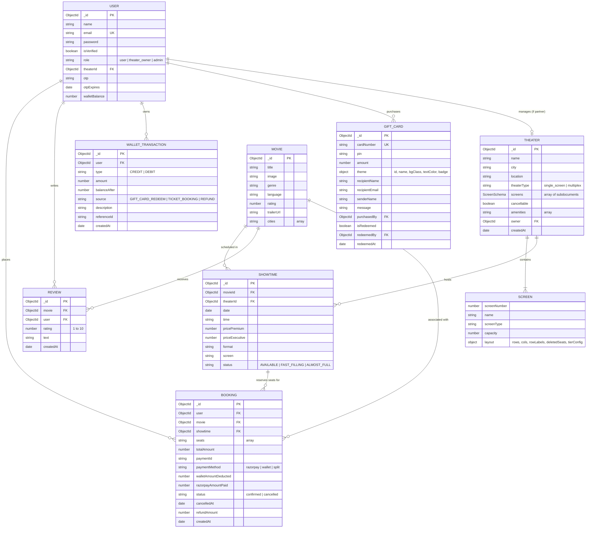

# BookMyShow - Full-Stack Cinema Ticket Booking & Multi-Tenant Theater Management Platform

[](https://react.dev/)
[](https://vitejs.dev/)
[](https://tailwindcss.com/)
[](https://nodejs.org/)
[](https://expressjs.com/)
[](https://www.mongodb.com/)
[](https://socket.io/)
[](https://razorpay.com/)

A production-grade, full-stack cinema ticketing ecosystem inspired by BookMyShow. The platform features an end-to-end customer booking flow, distributed real-time seat locking concurrency, a dedicated multi-tenant theater partner dashboard with an architectural auditorium seating layout studio, BMS wallet balance with split-payment checkout, 2-hour pre-show ticket cancellation with instant refunds, and a centralized administrative desk.

---

## Table of Contents

1. [Architectural Overview](#architectural-overview)
2. [Key Features](#key-features)
3. [Technology Stack](#technology-stack)
4. [Data Design & Schemas](#data-design--schemas)
5. [Real-Time Seat Concurrency Engine](#real-time-seat-concurrency-engine)
6. [API Documentation](#api-documentation)
7. [Installation & Local Setup](#installation--local-setup)
8. [Database Seeding](#database-seeding)
9. [Deployment Guide](#deployment-guide)
10. [Default Credentials & Testing](#default-credentials--testing)

---

## Architectural Overview

The application is architected into three primary layers:



---

## Key Features

### 1. Customer Ticketing & Discovery Portal
- **City-Aware Cataloging**: Browse upcoming and running movies across Indian metropolitan hubs (Hyderabad, Mumbai, Delhi-NCR, Bengaluru, Chennai, Pune, etc.).
- **Smart Date & Format Filters**: Filter showtimes by audio format (Dolby Atmos, Barco 4K Laser, HDR), budget ranges, and preferred viewing times (Morning, Afternoon, Evening, Night).
- **Automated Expired Show Protection**: Showtimes whose scheduled start time has passed are automatically disabled (`line-through`, "Closed" badge) to prevent invalid bookings. Direct URLs to expired showtimes display an informative expiration barrier.
- **Continuous Seating Grid**: Seating layouts maintain continuous seat numbering (e.g. `1, 2, 3, [walkway], 4, 5...`) so seat numbers match the physical cinema rows without skipping indices.
- **Grab-a-Bite Food & Beverage Integration**: Add popcorn, snacks, and beverages to tickets prior to checkout.
- **Split Payment & BMS Wallet Engine**: 
  - Pay 100% using BookMyShow Wallet balance without touching external gateways.
  - Partial wallet split: Pay part via wallet and remainder via Razorpay (UPI, Credit/Debit cards, NetBanking).
- **Official E-Ticket & Calendar Sync**: Confirmed bookings generate a scannable QR ticket pass with print/PDF styling and 1-click `.ics` calendar sync for Apple and Google Calendar.
- **2-Hour Pre-Show Cancellation**:
  - Customers can cancel tickets strictly up to 2 hours before the scheduled showtime.
  - 100% of the ticket amount is instantly refunded to their BMS Wallet.
  - Cancelled seats are immediately released via WebSockets so other customers can book them.
- **Gift Cards & Wallet Vouchers**: Buy themed digital gift cards with custom messages and redeem 16-digit card codes into wallet balances.

### 2. Multi-Tenant Theater Partner Portal
- **Auditorium Layout Studio**:
  - Configure seating dimensions up to 26 rows × 30 columns.
  - Click any seat cell to toggle aisle walkway spaces.
  - Assign row categories (`Recliner`, `Prime / Premium`, `Classic / Executive`) with one-click row tier cycling (`REC` ➔ `PRM` ➔ `CLS`).
  - One-click presets: *Center Walkway*, *Dual Aisles*, *Standard Mix*, and *VIP All-Recliner*.
  - Live inventory HUD calculating active seating capacity by category.
- **Programming Desk**: Schedule single or multi-day showtimes across multiple screens with collision prevention.
- **Real-Time Floor Supervisor**: Live cinema floor inspector displaying real-time held seats, sold-out seats, active buyers, and supervisor lock overrides.
- **Gate Turnstile Scanner**: In-browser QR code scanner using device camera (`html5-qrcode`) to validate tickets at the auditorium entrance.

### 3. Administrator Operations Desk
- **Admissions Ledger**: Real-time record of all ticket bookings across all cinemas.
- **Revenue Analytics**: Interactive 7-day revenue charts and admission volume tracking powered by Recharts.
- **Theater Verification**: Register new cinemas, edit screen capacities, configure amenities, and reset partner passwords.
- **Traffic & Concurrency Simulator**: Benchmark distributed seat locks by simulating live concurrent buyers and monitoring telemetry.

---

## Technology Stack

| Layer | Technologies |
|---|---|
| **Frontend Framework** | [React 19](https://react.dev/), [Vite 8](https://vitejs.dev/) |
| **Styling & Icons** | [Tailwind CSS v4](https://tailwindcss.com/), [Lucide React](https://lucide.dev/) |
| **Routing & Navigation** | [React Router v7](https://reactrouter.com/) |
| **Charting & Telemetry** | [Recharts](https://recharts.org/) |
| **Real-Time Communication** | [Socket.IO Client](https://socket.io/) |
| **Camera QR Scanning** | [html5-qrcode](https://github.com/mebjas/html5-qrcode) |
| **Backend Runtime** | [Node.js](https://nodejs.org/) (v18+ LTS or v20+) |
| **HTTP Framework** | [Express 5](https://expressjs.com/) |
| **Database & ODM** | [MongoDB](https://www.mongodb.com/) via [Mongoose 9](https://mongoosejs.com/) |
| **Schema Validation** | [Zod](https://zod.dev/) |
| **Authentication** | [JSON Web Tokens (JWT)](https://jwt.io/), [bcryptjs](https://github.com/dcodeIO/bcrypt.js) |
| **Payments** | [Razorpay Node SDK](https://razorpay.com/docs/api/) |
| **Email Services** | [Nodemailer](https://nodemailer.com/) (Gmail SMTP) |

---

## Data Design & Schemas



### Key Model Details

#### 1. Theater & Screen Layout Subdocument
- `screens.layout.rows` (Number): Number of vertical grid rows (e.g. 8).
- `screens.layout.cols` (Number): Number of horizontal grid columns (e.g. 12).
- `screens.layout.deletedSeats` (Array of Strings): Grid coordinates marking aisle gaps (e.g. `['A5', 'A6', 'B5']`).
- `screens.layout.tierConfig`:
  - `reclinerRows` (Array of Strings): Rows assigned as Recliner (e.g. `['A']`).
  - `premiumRows` (Array of Strings): Rows assigned as Prime (e.g. `['B', 'C', 'D']`).
  - `executiveRows` (Array of Strings): Rows assigned as Classic (e.g. `['E', 'F', 'G']`).

#### 2. Booking Model
- Tracks split payments: `walletAmountDeducted` and `razorpayAmountPaid`.
- Lifecycle status: `confirmed` or `cancelled`.
- Cancellation audit: `cancelledAt` timestamp and `refundAmount` credited to wallet.

---

## Real-Time Seat Concurrency Engine

The backend implements an in-memory high-throughput mutex engine in [`backend/sockets/seatLockEngine.js`](file:///c:/Users/91781/OneDrive/Desktop/icl/backend/sockets/seatLockEngine.js) to prevent double-booking collisions:

- **8-Minute Distributed Lock TTL**: When a user selects a seat, it is locked in the showtime room for 480 seconds.
- **Real-Time Client Broadcasting**:
  - `join_showtime`: Client joins `showtime_{showtimeId}` room and receives `initial_locks` and live `viewers_count`.
  - `lock_seat`: Emits `seat_locked_by_other` with animated pulse indicator to all other viewers.
  - `unlock_seat`: Releases lock and emits `seat_unlocked`.
  - `seats_permanently_booked`: Triggered on verified payment; permanently marks seats as booked and invalidates held locks.
  - `seats_released`: Triggered on ticket cancellation; immediately releases seats back to the public pool.
  - `force_unlock_seat`: Allows floor supervisors to break abandoned or stale locks.

---

## API Documentation

All REST routes are mounted under `/api`. Protected routes require an `Authorization: Bearer <jwt_token>` header.

### 1. Authentication & Profile (`/api/auth`)

| Method | Endpoint | Auth | Description |
|---|---|---|---|
| `POST` | `/api/auth/register` | Public | Register customer account and send 6-digit verification OTP |
| `POST` | `/api/auth/verify-otp` | Public | Verify registration OTP and activate customer profile |
| `POST` | `/api/auth/login` | Public | Authenticate customer and return JWT token |
| `POST` | `/api/auth/partner/register` | Public | Self-serve theater partner registration |
| `POST` | `/api/auth/partner/login` | Public | Authenticate theater partner credentials |
| `GET` | `/api/auth/profile` | Required | Retrieve customer profile, current wallet balance, and populated bookings |
| `PUT` | `/api/auth/profile` | Required | Update customer personal information (name) |
| `POST` | `/api/auth/bookings/:id/cancel` | Required | Cancel booking (if > 2 hours before show) and credit full refund to wallet |

#### Example: Cancel Booking Request & Response
```http
POST /api/auth/bookings/6728e9301293ab3450/cancel
Authorization: Bearer <token>
```
```json
{
  "success": true,
  "msg": "Booking cancelled successfully! ₹350 has been refunded to your BookMyShow Wallet.",
  "booking": {
    "_id": "6728e9301293ab3450",
    "status": "cancelled",
    "refundAmount": 350,
    "cancelledAt": "2026-11-04T12:00:00.000Z"
  },
  "walletBalance": 850
}
```

---

### 2. Movies & Reviews (`/api/movies`)

| Method | Endpoint | Auth | Description |
|---|---|---|---|
| `GET` | `/api/movies` | Public | Get running movies. Supports query filters: `?city=Hyderabad&all=true` |
| `POST` | `/api/movies` | Public | Add new movie to global catalog |
| `GET` | `/api/movies/:id` | Public | Get single movie details by ID |
| `GET` | `/api/movies/:id/booked-seats` | Public | Get all booked seats across all showtimes for a movie |
| `GET` | `/api/movies/:id/reviews` | Public | Get user reviews and ratings for a movie |
| `POST` | `/api/movies/:id/reviews` | Required | Submit customer review (rating 1-10 and commentary) |

---

### 3. Public Theaters & Showtimes (`/api/theaters`)

| Method | Endpoint | Auth | Description |
|---|---|---|---|
| `GET` | `/api/theaters` | Public | Get all active cinema properties (optional filter: `?city=Mumbai`) |
| `GET` | `/api/theaters/showtime/:id` | Public | Get showtime details with populated movie and theater info |
| `GET` | `/api/theaters/showtime/:id/booked-seats` | Public | Get booked seats for a showtime (automatically excludes cancelled seats) |
| `GET` | `/api/theaters/:movieId/showtimes` | Public | Get showtimes for a movie grouped by cinema (`?city=Hyderabad&date=YYYY-MM-DD`) |

---

### 4. Theater Partner Management (`/api/theaters/partner`)

| Method | Endpoint | Auth | Description |
|---|---|---|---|
| `GET` | `/api/theaters/partner/my-theater` | Required | Fetch partner's cinema profile, screens, layouts, and amenities |
| `GET` | `/api/theaters/partner/showtimes` | Required | Fetch all programmed showtimes for partner's cinema |
| `POST` | `/api/theaters/partner/showtimes` | Required | Schedule showtimes across multiple dates and screens |
| `PUT` | `/api/theaters/partner/showtimes/:id/price`| Required | Update Executive and Premium ticket pricing for a showtime |
| `DELETE`| `/api/theaters/partner/showtimes/:id` | Required | Remove scheduled showtime |
| `POST` | `/api/theaters/partner/add-movie` | Required | Add a title directly into the cinema's programming catalog |
| `PUT` | `/api/theaters/partner/screens/:screenNumber/layout` | Required | Save custom rows, columns, aisles, and tiers for a screen |
| `POST` | `/api/theaters/partner/validate-ticket` | Required | Scan and validate customer ticket QR code at gate turnstile |

---

### 5. Payments & Bookings (`/api/payment`)

| Method | Endpoint | Auth | Description |
|---|---|---|---|
| `POST` | `/api/payment/orders` | Public | Create Razorpay order (enforces expiration check on showtime) |
| `POST` | `/api/payment/verify` | Required | Verify HMAC-SHA256 signature, deduct partial wallet balance, and issue ticket |
| `POST` | `/api/payment/pay-with-wallet` | Required | Instantly book ticket with 100% wallet deduction without gateway redirect |

---

### 6. Gift Cards & BMS Wallet (`/api/giftcards` & `/api/wallet`)

| Method | Endpoint | Auth | Description |
|---|---|---|---|
| `POST` | `/api/giftcards/orders` | Public | Create Razorpay order to purchase digital gift cards |
| `POST` | `/api/giftcards/verify` | Public | Verify payment and issue unique 16-digit card number and 4-digit PIN |
| `POST` | `/api/giftcards/check-balance` | Public | Check status and unredeemed balance of any gift card |
| `POST` | `/api/giftcards/redeem` | Required | Redeem gift card value into authenticated user's BMS Wallet balance |
| `GET` | `/api/wallet/balance` | Required | Fetch current wallet balance and full ledger transaction history |

---

### 7. Administration Desk (`/api/admin`)

| Method | Endpoint | Auth | Description |
|---|---|---|---|
| `GET` | `/api/admin/dashboard` | Admin | High-level metrics (total movies, active bookings, gross revenue) |
| `GET` | `/api/admin/bookings` | Admin | Complete admissions ledger of all customer ticket purchases |
| `GET` | `/api/admin/analytics` | Admin | 7-day revenue and admission volume trends for chart plotting |
| `GET` | `/api/admin/theaters` | Admin | List all registered cinema properties |
| `POST` | `/api/admin/theaters` | Admin | Onboard new cinema property and provision partner credentials |
| `PUT` | `/api/admin/theaters/:id` | Admin | Update cinema details, location, and amenities |
| `DELETE`| `/api/admin/theaters/:id` | Admin | Remove cinema property |
| `POST` | `/api/admin/theaters/:id/reset-password` | Admin | Reset partner manager account password |
| `POST` | `/api/admin/add-show` | Admin | Global show programming desk across any theater |
| `POST` | `/api/admin/validate-ticket` | Admin | Central gate validator for verifying customer tickets |
| `POST` | `/api/admin/simulate-traffic` | Admin | Inject synthetic concurrent buyer traffic for stress testing |
| `POST` | `/api/admin/clear-demo-bookings`| Admin | Purge simulated demo bookings and reset seat state |
| `GET` | `/api/admin/telemetry-stats` | Admin | Live telemetry statistics on active sockets and seat locks |

---

## Installation & Local Setup

### Prerequisites
- [Node.js](https://nodejs.org/) v18.0.0 or higher
- [npm](https://www.npmjs.com/) v9.0.0 or higher
- A running [MongoDB](https://www.mongodb.com/) instance (local `mongodb://localhost:27017` or MongoDB Atlas URI)
- (Optional) [Razorpay Test Account](https://dashboard.razorpay.com/) for test credentials

---

### 1. Clone the Repository
```bash
git clone https://github.com/ChandanaVenkateswaraRao/Venkatesh_40276_web_dev_ICL.git
cd Venkatesh_40276_web_dev_ICL
```

---

### 2. Configure Backend Environment

Navigate to the `backend` folder and create a `.env` file from the example:
```bash
cd backend
cp .env.example .env
```

Configure your `.env` variables:
```env
PORT=5000
MONGO_URI=mongodb+srv://<username>:<password>@cluster0.mongodb.net/bookmyshow?retryWrites=true&w=majority
JWT_SECRET=your_super_secret_jwt_key_32_chars_long
RAZORPAY_KEY_ID=rzp_test_your_key_id
RAZORPAY_KEY_SECRET=your_razorpay_secret_key
SMTP_USER=your_email@gmail.com
SMTP_PASS=your_gmail_app_password
```

Install backend dependencies and run the server:
```bash
npm install
npm run dev
```
The API server will listen on `http://localhost:5000`.

---

### 3. Seed Database with Initial Data

In the `backend` directory, run the seed script to populate movies, multi-city theaters, screens, and upcoming showtimes:
```bash
npm run seed
```

---

### 4. Configure Frontend Environment

Open a new terminal, navigate to the `frontend` folder, and configure `.env`:
```bash
cd frontend
cp .env.example .env
```

Update your `.env` variables:
```env
VITE_BACKEND_URL=http://localhost:5000
VITE_API_URL=http://localhost:5000/api
VITE_RAZORPAY_KEY_ID=rzp_test_your_key_id
```

Install dependencies and start the Vite development server:
```bash
npm install
npm run dev
```
The frontend application will be accessible at `http://localhost:5173`.

---

## Database Seeding

The seed utility (`backend/seed.js`) automatically provisions:
1. **10+ Curated Movies**: Blockbusters (*Jailer 2*, *Dune: Part Two*, *Oppenheimer*, *Leo*, *The Batman*, *Barbie*, *Salaar*, *Interstellar*, etc.) with posters, trailers, genres, and languages.
2. **Major Multi-City Theaters**: Realistic cinema properties in Hyderabad (Prasads Multiplex, AMB Cinemas, PVR Inorbit), Mumbai (PVR ICON Phoenix, INOX Nariman Point), Bengaluru, Delhi-NCR, Chennai, and Pune.
3. **8-Day Showtime Matrix**: Schedules 4 to 7 showtimes per theater across today and the subsequent 7 days with Executive and Premium pricing tiers.

Run anytime to refresh your database:
```bash
cd backend
npm run seed
```

---

## Deployment Guide

### Deploy Backend (e.g. Render / Railway / Heroku)
1. Push repository to GitHub.
2. Create a new **Web Service** on [Render](https://render.com/) pointing to the root directory with subfolder `backend`.
3. Set build and start commands:
   - **Build Command**: `npm install`
   - **Start Command**: `node server.js`
4. In the Environment section, add all variables from `backend/.env.example`.
5. Note your deployed URL (e.g. `https://book-my-ticket-3brf.onrender.com`).

### Deploy Frontend (e.g. Vercel)
1. Import repository in [Vercel](https://vercel.com/).
2. Set **Root Directory** to `frontend`.
3. Add environment variables:
   - `VITE_BACKEND_URL`: `https://your-backend-url.onrender.com`
   - `VITE_API_URL`: `https://your-backend-url.onrender.com/api`
   - `VITE_RAZORPAY_KEY_ID`: `your_razorpay_key_id`
4. Deploy. Vercel will run `vite build` and serve the optimized client build.

---

## Default Portals & Verification

| Portal | URL Path | Description |
|---|---|---|
| **Customer App** | `/` | Browse movies, select city, choose seats, and book tickets |
| **User Profile & Bookings** | `/profile` | View booking history, download E-Ticket, cancel tickets |
| **Theater Partner Login** | `/partner/login` | Portal login for verified theater managers |
| **Partner Dashboard** | `/partner/dashboard` | Manage showtimes, live floor monitor, catalog |
| **Auditorium Studio** | `/partner/layout` | Design custom rows, columns, walkway aisles, and tiers |
| **Gate Security Scanner** | `/partner/scanner` | Camera QR scanner to validate customer tickets |
| **Operations Desk (Admin)**| `/admin` | High-level metrics, revenue charts, theater management |
| **Gift Card Store** | `/gift-cards` | Purchase digital gift cards and redeem into BMS Wallet |

---

## License

This project is licensed under the [ISC License](LICENSE).
